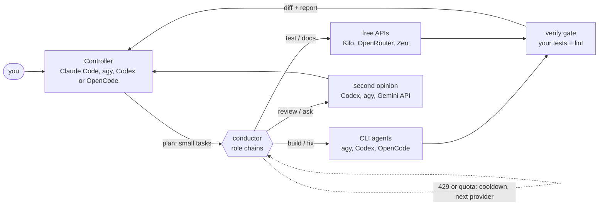
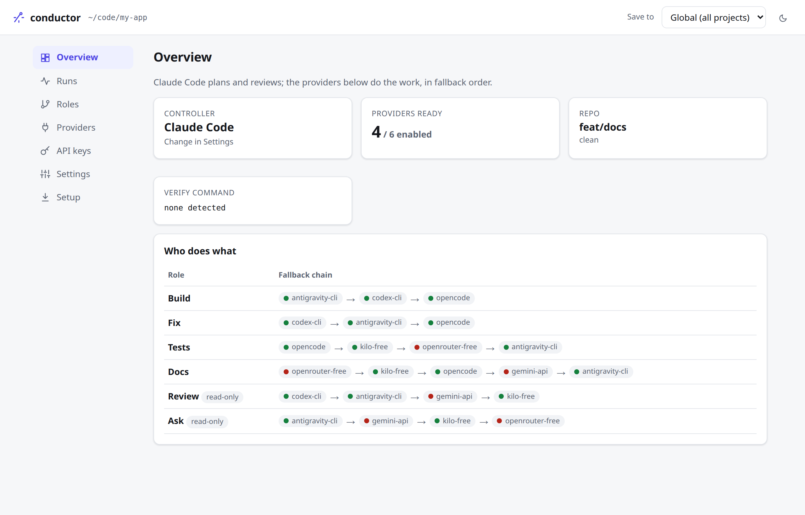
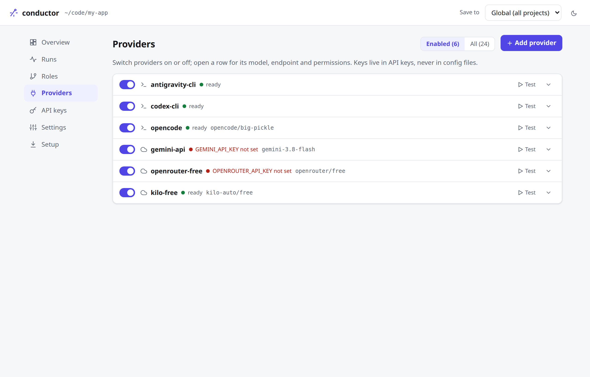
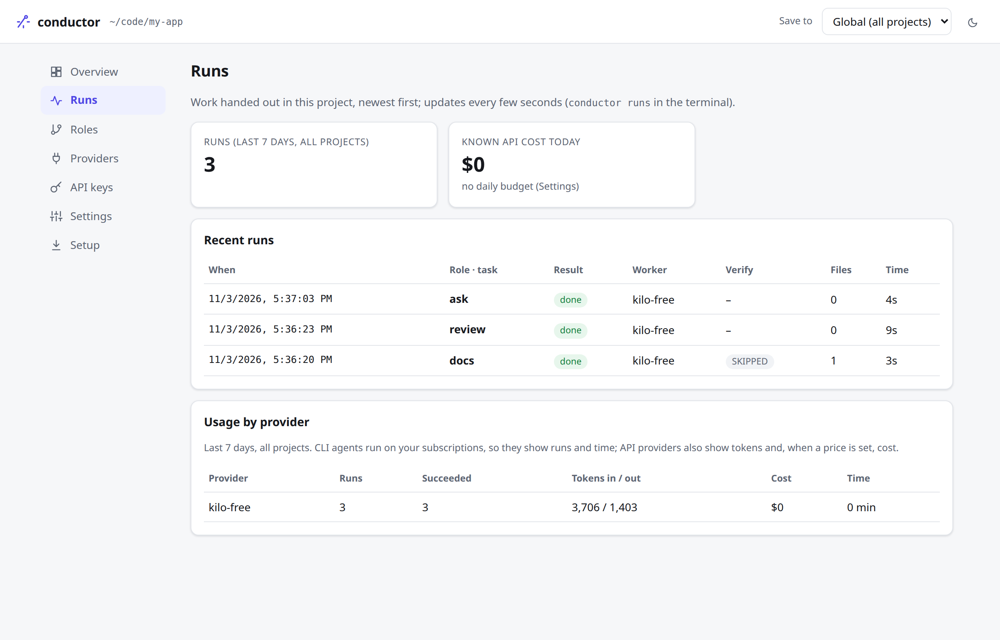

<div align="center">

<picture>
  <source media="(prefers-color-scheme: dark)" srcset="docs/assets/logo-dark.svg">
  <source media="(prefers-color-scheme: light)" srcset="docs/assets/logo-light.svg">
  
</picture>

### Claude plans and reviews. Free and cheap models write the code.

[](https://github.com/KevalParikh22/conductor-ai/actions/workflows/ci.yml)
[](CHANGELOG.md)
[](https://nodejs.org)
[](package.json)
[](docs/ARCHITECTURE.md)
[](LICENSE)

[Quick start](#quick-start) &middot; [How it works](#how-it-works) &middot; [Permissions](#every-agent-runs-under-its-own-rules) &middot; [Install guide](docs/INSTALL.md) &middot; [Providers](docs/PROVIDERS.md) &middot; [Changelog](CHANGELOG.md)

</div>

> **Status: early (v0.5), solo-maintained.** 41 tests, run in CI on Linux and macOS with Node 20, 22 and 24. The agents it drives change their CLI flags often; each one is a small preset you can override in config.

A Claude subscription runs out fast when Claude types every line. Claude is best at judgement: planning, design and catching bugs. **conductor-ai** keeps Claude (or any agent you choose) as the controller and quality gate, and hands the typing to Antigravity, Codex, OpenCode, free Kilo / OpenRouter / Groq / Gemini models, Kimi or local models. When one hits its limit, the next one takes over.

```bash
curl -fsSL https://raw.githubusercontent.com/KevalParikh22/conductor-ai/main/scripts/install.sh | bash
```

### At a glance

- **One controller, many workers.** Claude Code by default; Antigravity CLI, Codex CLI or OpenCode can be the controller too. Workers are picked per role (`build`, `fix`, `test`, `docs`, `review`, `ask`) from an ordered fallback chain.
- **Quota-aware fallback.** Rate limits (HTTP 429, CLI "usage limit" messages) put a provider on cooldown, honouring `Retry-After`, and the next one starts on a clean tree. If every provider fails, the controller does the task itself.
- **Free first.** Default chains lean on Kilo Gateway (no key needed), OpenCode's free models, OpenRouter `:free`, Gemini API and other free tiers, so your paid quota goes to planning and review.
- **Every agent under its own rules.** Each CLI gets permission rules for that run: write roles edit only the project and can't push; read roles can't edit; your API keys stay out of their environment. Your own CLI settings are never touched.
- **Parallel tasks.** `conductor batch` runs independent plan tasks at the same time, each in its own git worktree and branch, spread across providers. The controller reviews and merges.
- **Trust, but check.** Your tests and lint run after every write task, and the worker's list of changed files is compared with what git shows. Plans must answer their open questions before any task is handed out.
- **Usage and budgets.** Every run is logged with time, tokens and known cost; set a daily budget and paid APIs stop when it's reached. `conductor runs` and the Runs page show who did what.
- **Works everywhere.** Install once, `conductor init` in any repo. CLI and MCP server. Settings page in the browser. Zero dependencies, no telemetry.

### How it works



1. **Plan.** `/conduct-plan` first settles open questions (asking you when the code can't answer them), then writes `docs/plan/<feature>.md`: design notes plus small tasks (1–3 files each), each with a role, acceptance criteria and a verify command.
2. **Delegate.** `/conduct-run` sends each task to the first ready provider in its role's chain; independent tasks run in parallel worktrees.
3. **Verify.** conductor runs your verify command, checks the worker's claimed changes against git, and reports who did the work, changed files, PASS/FAIL and any mismatch.
4. **Review and commit.** The controller reads the diff, fixes small issues, retries with another provider, or does the task itself after two failures. A second model reviews the branch at the end.

### See it

<table>
<tr>
<td align="center" width="50%">
<picture>
  <source media="(prefers-color-scheme: dark)" srcset="docs/assets/ui-overview-dark.png">
  
</picture>
<sub><b>Overview</b>: who does what, and which providers are ready</sub>
</td>
<td align="center" width="50%">
<picture>
  <source media="(prefers-color-scheme: dark)" srcset="docs/assets/ui-providers-dark.png">
  
</picture>
<sub><b>Providers</b>: models, keys and each agent's permissions</sub>
</td>
</tr>
<tr>
<td align="center" colspan="2">
<picture>
  <source media="(prefers-color-scheme: dark)" srcset="docs/assets/ui-runs-dark.png">
  
</picture>
<br><sub><b>Runs</b>: who did what, verify results, evidence warnings and usage</sub>
</td>
</tr>
</table>

`conductor ui` opens this page on `127.0.0.1` (per-launch token, never exposed to the network).

### Quick start

```bash
npm install -g github:KevalParikh22/conductor-ai   # Node 20+
conductor setup                 # guided: finds your agents and keys, adds a free provider, tests
cd my-app && conductor init     # rules, commands, MCP entry
conductor add groq              # add any of 45 chat APIs: key, model, test, roles
```

Then, in Claude Code inside the project:

```text
/conduct-plan add password reset by email
/conduct-run docs/plan/password-reset.md
```

<details>
<summary><b>Install the worker agents</b> (at least one)</summary>
<br>

```bash
curl -fsSL https://antigravity.google/cli/install.sh | bash && agy   # sign in with Google once
npm install -g @openai/codex && codex login
curl -fsSL https://opencode.ai/install | bash                          # free models
```

Free API providers need no install: `kilo-free` works without a key; add more with `conductor add <name>` (45 chat APIs: [setup guides](docs/providers/README.md)). Full guide: [docs/INSTALL.md](docs/INSTALL.md).

</details>

<details>
<summary><b>Use a different controller</b></summary>
<br>

```bash
conductor init --controller antigravity   # writes .agents/skills/conduct-* and .agents/mcp_config.json
conductor init --controller codex-cli     # AGENTS.md + prompts in .conductor/commands
conductor init --controller opencode      # AGENTS.md + opencode.json MCP entry
```

</details>

### Every agent runs under its own rules

conductor passes each CLI its permission rules **for that run only**, through the CLI's own sandbox or permission system. No "skip all permissions" flags.

| Agent | Write roles (`build`, `fix`, `test`, `docs`) | Read roles (`review`, `ask`) |
|---|---|---|
| **Antigravity** (`agy`) | `--sandbox`: commands run without network, home folder read-only; `.git`, `.env` files and conductor's folder denied | writes to the project denied |
| **Codex** | OS sandbox `workspace-write`, no network, never asks | OS sandbox `read-only` |
| **OpenCode** | edits inside the project; outside folders denied (shell not OS-sandboxed) | edits, web and mutating shell commands denied |
| **Claude Code** | edits auto-approved; other commands that would ask are refused | edit tools disabled |
| **Copilot CLI** | `--allow-all-tools` with git/sudo denied (deny wins); file tools limited to the project; shell not OS-sandboxed | write tools and shell denied |
| **Aider** | edits in the repo only; no shell, no auto-commits, project `.env` not loaded | `--dry-run` |
| **Grok Build** | kernel sandbox (`strict`): project and temp only, no network for commands on Linux; git/sudo denied | `read-only` sandbox, read tools only |
| **Kiro** | commands in its OS sandbox, network blocked; `.git` writes refused | only read and search tools |
| **Goose** | no permission control: use in a throwaway worktree | tool-less chat mode |
| **Kimi**, custom CLIs | no permission control: use in a throwaway worktree | ⚠ not enforced, runs warn |

For every agent: no `git push`, `commit`, `reset`, `checkout`, `rebase`, `stash`, `clean` or `sudo`; only the API key that CLI needs is passed to it. conductor adds its own guards on top: clean tree and non-protected branch for write roles, failed attempts stashed (never lost), and changes to `AGENTS.md`, plans and controller files reverted. Details and the exact flags: [Providers → Permissions](docs/PROVIDERS.md#permissions-what-each-agent-may-do).

**Is it safe?** Read [SECURITY.md](SECURITY.md): what conductor guards (sandboxes, scrubbed keys, git hooks and config restored after every worker, checked model output), what it can't (tests run code the worker wrote; agents can read what you can read; free routes may log prompts), and a checklist for sensitive projects.

### Providers

| | Built in |
|---|---|
| **Local agents** | Antigravity CLI · Codex CLI · OpenCode · GitHub Copilot CLI · Grok Build · Kiro · Aider · Goose · Kimi CLI · Claude Code · any CLI you add |
| **Free APIs** | Kilo Gateway and OVHcloud (no key) · OpenRouter `:free` · Gemini API · Groq · Cerebras · Cohere trial · NVIDIA NIM · Hugging Face credits |
| **Gateways** | OpenRouter · Requesty · Vercel AI Gateway · Hugging Face · Cloudflare Workers AI · Poe · AI/ML API |
| **Model makers** | OpenAI · Claude API · Gemini · xAI · Mistral · DeepSeek · Kimi · Qwen · GLM · MiniMax |
| **Fast hosts** | Groq · Cerebras · SambaNova · Together · Fireworks · DeepInfra · Novita · Nebius · Baseten · and more |
| **Clouds** | Azure OpenAI · Amazon Bedrock · anything else through a LiteLLM proxy |
| **Local models** | Ollama · LM Studio · llama.cpp · vLLM · LocalAI · Jan |

Chat APIs can't run your tests, so conductor applies the files they return (refusing paths outside the repo) and runs verify for them. `conductor models <provider>` lists current models; free lists change weekly.

Every one has a setup guide: **[docs/providers](docs/providers/README.md)**. See them all with `conductor providers`; add one with `conductor add <name>` or the **Add a provider** gallery in `conductor ui`. Any other OpenAI-compatible endpoint works too.

<details>
<summary><b>Commands</b></summary>
<br>

| In your controller | What it does |
|---|---|
| `/conduct-status` | Providers ready, missing or cooling down, plus role chains |
| `/conduct-plan <feature>` | Writes a plan of delegable tasks |
| `/conduct-run <plan>` | Runs the whole plan in waves (parallel where possible), then review |
| `/conduct-build <plan> <task> [provider]` | Runs one task |
| `/conduct-test <what>` · `/conduct-docs <what>` | Tests and docs via free models |
| `/conduct-review [--plan f]` | Second-opinion review, triaged by the controller |
| `/conduct-ask <question>` | Codebase questions answered by a big-context model |
| `/conduct-handoff` | Updates `HANDOFF.md` so any tool can continue |

| CLI | |
|---|---|
| `conductor run <role> [task] [--plan f --task T1] [--provider p] [--chain a,b] [--note …] [--files a,b] [--json]` | Delegate with fallback |
| `conductor build\|fix\|test\|docs\|review\|ask …` | Shortcuts for `run <role>`; add `--worktree` to run on branch `conductor/<id>` |
| `conductor batch --plan f --tasks T2,T3 [--concurrency 4]` | Independent tasks in parallel, one worktree each |
| `conductor worktree [list]` · `conductor worktree rm <id>\|--all [--force]` | See and clean up worktrees |
| `conductor init [--controller claude-code\|antigravity\|codex-cli\|opencode]` | Set up a project |
| `conductor ui` · `conductor status` · `conductor doctor [--live]` · `conductor verify` | Manage and check |
| `conductor runs [show <run>]` · `conductor usage [--days 7]` | Run history; runs, tokens and cost per provider |
| `conductor models [provider]` · `conductor cooldown [--clear]` · `conductor mcp` | Model lists, rate-limit state, MCP server |

Exit codes: `0` ok · `2` usage or unsafe repo state · `3` every provider failed (the controller takes over).

</details>

### Docs

| Page | What it covers |
|---|---|
| [Install guide](docs/INSTALL.md) | Step by step, for every project |
| [Configuration](docs/CONFIGURATION.md) | Roles, providers, settings, config files |
| [Providers](docs/PROVIDERS.md) | Every provider, free tiers, permissions, adding your own |
| [tmux and editors](docs/EDITORS.md) | tmux layout, VS Code (Claude Code, Copilot agent mode), Cursor |
| [Local, cloud and CI](docs/CLOUD.md) | Claude Code on the web, GitHub Actions, servers |
| [Security](SECURITY.md) | What is protected, known limits, setup for sensitive code |
| [How it works](docs/ARCHITECTURE.md) | Design, safety model, parallel runs, inspirations |

### Honest limits

- Workers are weaker than Claude at judgement. That's why plans are detailed, tasks stay small, and every diff passes verify and the controller's review.
- Chat-only API models can't run your tests; prefer CLI agents for `build`, APIs for `docs`, `test` and `ask`.
- OpenCode's shell and agents without a sandbox (Kimi, custom CLIs) are only as contained as their own permission systems allow.
- Cost is only known for API providers with a `price` set; CLI agents on subscriptions are counted in runs and minutes.

### Contributing · security · license

Issues and pull requests are welcome: see [CONTRIBUTING.md](CONTRIBUTING.md). Report security problems privately as described in [SECURITY.md](SECURITY.md). MIT licensed.

<div align="center"><sub>If conductor-ai saves you quota, a ⭐ helps the next person find it.</sub></div>
